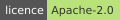
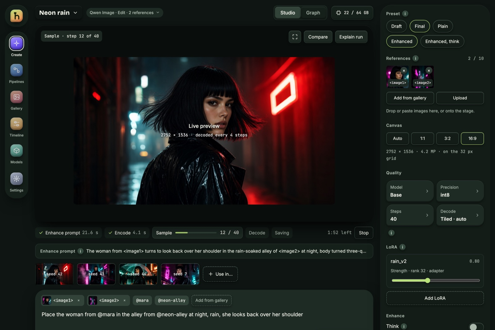
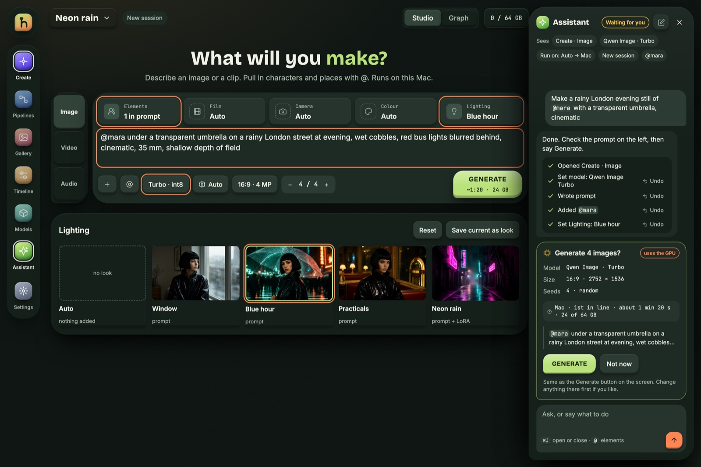
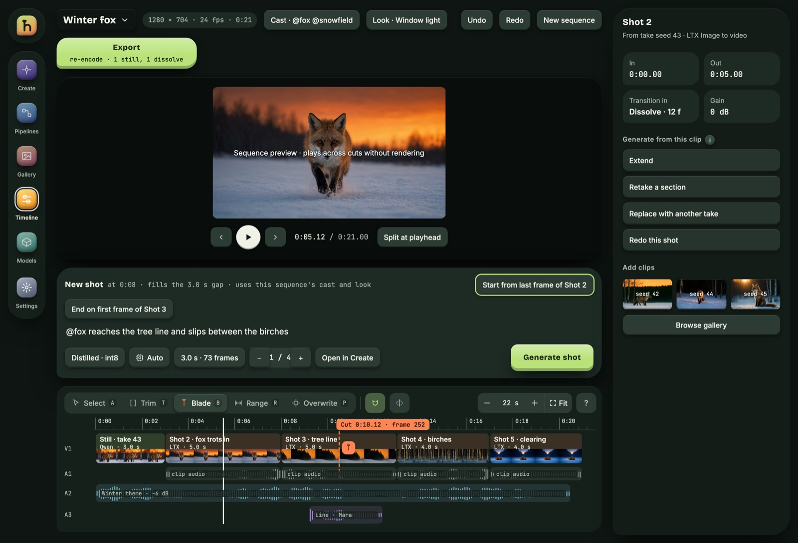
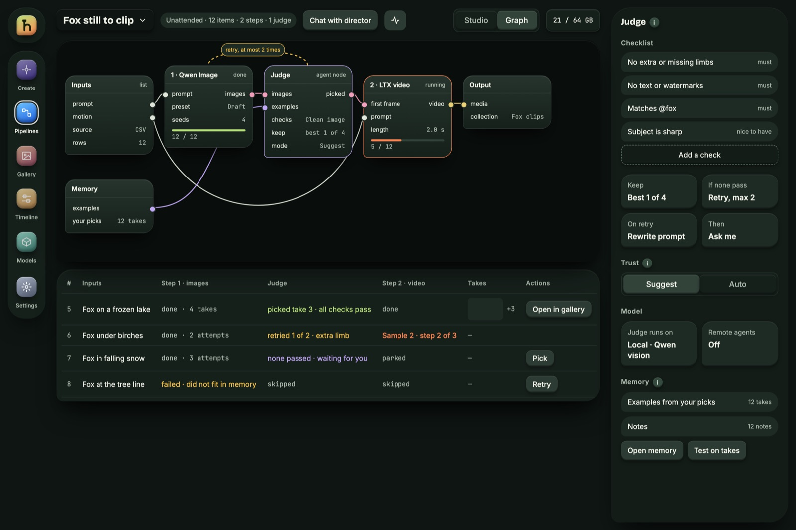
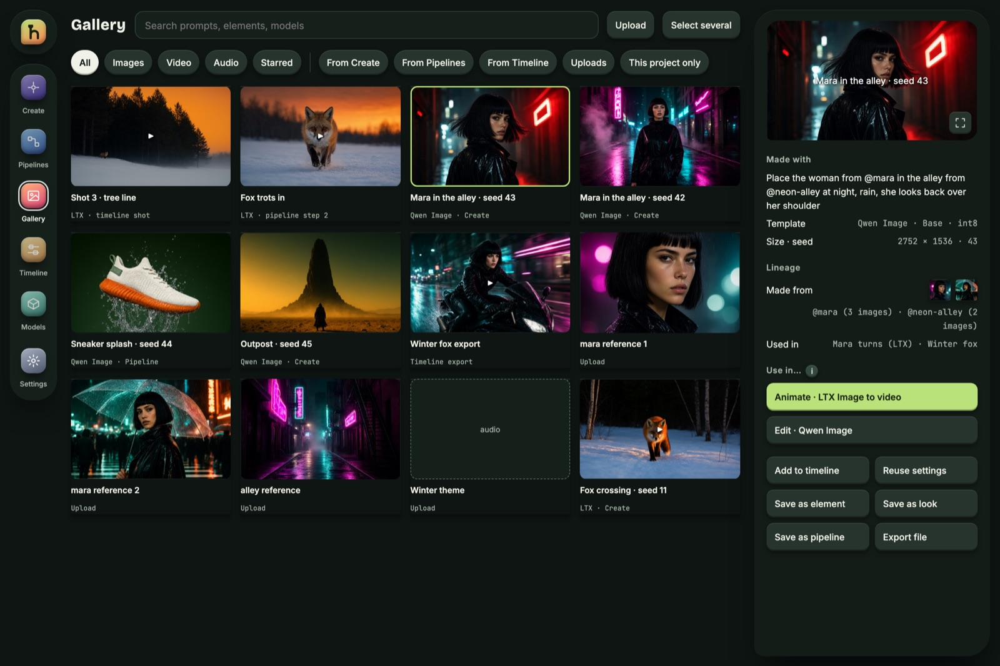
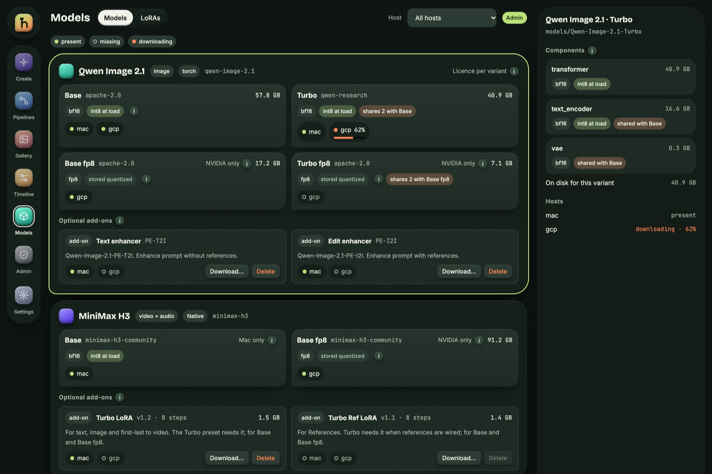
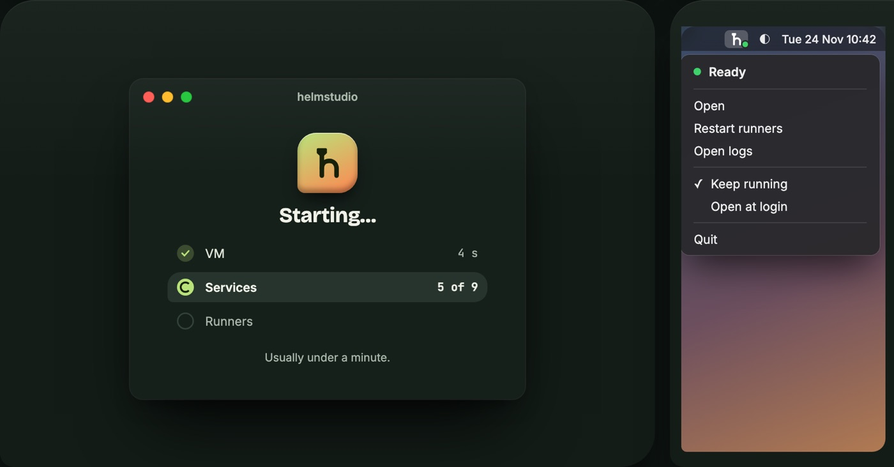

<p align="center">
  
</p>

<h1 align="center">helmstudio <sup>alpha</sup></h1>

<p align="center">
  <strong>Wire the models. Direct the film.</strong><br>
  A local-first AI studio for images, video and voice. It runs open-weight models on your own Mac and NVIDIA
  machines, and keeps every take with how it was made.
</p>

<p align="center">
  <strong>Alpha:</strong> helmstudio is in early development. Expect rough edges and breaking changes between
  releases; please <a href="https://github.com/janishar/helmstudio/issues">report what breaks</a>.
</p>

<p align="center">
  
  <a href="LICENSE"></a>
  <a href="https://helmstudio.in"></a>
  
</p>

<p align="center">
  <a href="https://helmstudio.in/start/install/">Install</a> ·
  <a href="https://helmstudio.in/start/introduction/">What is helmstudio</a> ·
  <a href="https://helmstudio.in/models/">Models</a> ·
  <a href="https://helmstudio.in/mcp/">Use it from Claude</a> ·
  <a href="https://helmstudio.in/reference/architecture/">Architecture</a>
</p>

<p align="center">
  
</p>

## What you can do

- **Create images, video and voice.** Pick a model, write a prompt, make takes. Call characters and places by name
  with `@`, and set a look (film, camera, colour, lighting) once.
- **Work with the Assistant.** An in-app assistant drives every screen: it fills the form, wires the graph, places
  clips and asks before anything that costs GPU time. Each step it takes has its own Undo.
- **See a workflow two ways.** Every workflow is a small graph of typed steps, shown as a **Studio** form or as a
  **Graph** on a node canvas. Editing one edits the other.
- **Run pipelines while you are away.** Chain workflows and run them over a list. Agent nodes judge each take
  against your checklist, rewrite the prompt and retry, and learn from the takes you keep.
- **Keep everything in the Gallery.** Every take keeps the exact settings and inputs that made it. Send any take to
  Create, a pipeline or the timeline.
- **Cut on the Timeline.** Put takes in a sequence, direct new shots and voice lines in place, trim, blade and
  ripple, and export an MP4.
- **Manage models.** Download weights per machine, pick variants (Base, Turbo, Distilled, community fp8 / int8),
  add optional add-ons, and upload LoRAs to a shared library.
- **Use it from Claude.** `helm mcp` gives Claude Code, Claude Desktop and other MCP clients the same tools as the
  Assistant. Costly or destructive tools ask first.
- **Host it for a team.** Self-hosted and multi-user. An admin adds accounts; each person sees only their own work.
  Nothing you make leaves your machines.
- **Try the Mac app.** A prototype `helmstudio.app` runs the whole studio on one Mac, with a menu-bar item.

## A look inside

<table>
  <tr>
    <td width="50%"></td>
    <td width="50%"></td>
  </tr>
  <tr>
    <td><b>Create + Assistant.</b> Ask for a rainy neon still of @mara: the Assistant fills the form, rings what it changed, and asks before it uses the GPU.</td>
    <td><b>Timeline.</b> Cut the Winter fox film with Select, Trim, Blade, Range and Overwrite, snap and zoom, and direct a new shot into a gap.</td>
  </tr>
  <tr>
    <td></td>
    <td></td>
  </tr>
  <tr>
    <td><b>Pipelines.</b> Fox stills become clips while you are away. A judge checks each take, keeps the best, retries the rest, and waits for you when none pass.</td>
    <td><b>Gallery.</b> Every take, from every campaign, with what made it, where it came from, and where it was used.</td>
  </tr>
  <tr>
    <td></td>
    <td></td>
  </tr>
  <tr>
    <td><b>Models.</b> Variants, sizes, licences and which machine has them; downloads per host.</td>
    <td><b>Mac app.</b> One window to start the studio, and a menu-bar item that keeps it running.</td>
  </tr>
</table>

<sub>Screens are from the approved design boards in <a href="docs/mock/">docs/mock</a>. Every picture in them was made by helmstudio with Qwen Image Turbo.</sub>

## Models

Weights are never in this repository. An admin downloads them per machine on the Models screen, and each keeps its
own licence.

| Family | Makes | Mac | NVIDIA |
|---|---|---|---|
| [Qwen Image 2.1](https://helmstudio.in/models/qwen-image/) | Images, edits | Base, Turbo | Base, Turbo, fp8 |
| [MiniMax H3 Image](https://helmstudio.in/models/minimax-h3-image/) | Images, edits | Base | Base, fp8 |
| [LTX-2.5](https://helmstudio.in/models/ltx/) | Video with sound | Distilled, Dev (MLX) | Distilled fp8, Dev int8 |
| [MiniMax H3](https://helmstudio.in/models/minimax-h3/) | Video with sound | Base (native `h3`) | Base fp8 (SGLang) |
| [Qwen3-TTS](https://helmstudio.in/models/qwen3-tts/) | Voice-over, voice design, dialogue | Custom voice, Voice design | Custom voice, Voice design |
| [ZONOS3](https://helmstudio.in/models/zonos3/) | Voice-over, dialogue | Mini | Mini |
| [Ask](https://helmstudio.in/models/ask/) | Text answers about takes | Qwen3.8 27B, Qwen3-VL 8B | Qwen3-VL 8B |

Variants, precision, add-ons, LoRAs and licences: [helmstudio.in/models](https://helmstudio.in/models/).

## Documentation

The full docs are at **[helmstudio.in](https://helmstudio.in)**.

| Start | Use | Reference |
|---|---|---|
| [What is helmstudio](https://helmstudio.in/start/introduction/) | [Create](https://helmstudio.in/studio/create/) | [Architecture](https://helmstudio.in/reference/architecture/) |
| [Install and run](https://helmstudio.in/start/install/) | [Assistant](https://helmstudio.in/studio/assistant/) | [API overview](https://helmstudio.in/reference/api/) |
| [Hosts and runners](https://helmstudio.in/start/hosts/) | [Pipelines and batches](https://helmstudio.in/studio/pipelines/) | [MCP (use it from Claude)](https://helmstudio.in/mcp/) |
| [The Mac app](https://helmstudio.in/start/mac-app/) | [Gallery](https://helmstudio.in/studio/gallery/) · [Timeline](https://helmstudio.in/studio/timeline/) | [MCP tools](https://helmstudio.in/mcp/tools/) · [helm CLI](https://helmstudio.in/mcp/helm-cli/) |
| [Production on a Mac](https://helmstudio.in/start/production/) | [Models](https://helmstudio.in/studio/models/) · [Admin](https://helmstudio.in/studio/admin/) | [FAQ](https://helmstudio.in/help/faq/) · [Troubleshooting](https://helmstudio.in/help/troubleshooting/) |

The design plan and decisions live in [docs/](docs/README.md).

## Quick start

Needs a Mac with Apple Silicon, Docker with Compose 2.20 or later (OrbStack or Docker Desktop), `make` and `openssl`.
The native runners also need [uv](https://docs.astral.sh/uv/), the Xcode Command Line Tools, CMake and Rust.

```sh
git clone https://github.com/janishar/helmstudio.git && cd helmstudio
make envs                 # the .env files from their examples
# now set ADMIN_EMAIL and ADMIN_PASSWORD in auth_service/.env
make up                   # makes the secrets, builds, starts, waits until healthy
open http://localhost:8300
```

Sign in as the admin and add people on Admin › Users (there is no public sign-up). The stack ships a test host with an Echo workflow, so you
can try the studio before any model is installed. For real models, start the runners on this Mac:

```sh
HELMSTUDIO_MODELS=~/models make runners    # torch, mlx and native, in the background
```

Weights are read from `HELMSTUDIO_MODELS` and never downloaded into an image. Download them on the Models screen.

| Command | What it does |
|---|---|
| `make up` / `make down` | Start the stack and wait until healthy / stop it (the data stays) |
| `make logs s=studio` · `make ps` | Follow one service's logs (no `s`: all) · show what is running |
| `make runners` / `make runners-stop` | Start / stop the native runners of this Mac |
| `make prod` | Run the checkout as production next to the dev stack (Kong on 8400) |

To use the studio from Claude Code, build the CLI, sign in once in a real terminal (it asks for the password), and
add it as an MCP server ([details](https://helmstudio.in/mcp/)):

```sh
make -C cli build
cli/bin/helm login --url http://localhost:8300 --email <your ADMIN_EMAIL> \
  --api-key-file deploy/secrets/helm_api_key
claude mcp add -s user helmstudio -- "$PWD/cli/bin/helm" mcp
```

Add an NVIDIA machine: [Hosts and runners](https://helmstudio.in/start/hosts/). Production on a Mac:
[Run in production](https://helmstudio.in/start/production/).

<details>
<summary><b>Operations notes</b> (test stack, runners, GPU hosts, ports, upgrades)</summary>

**Test stack.** `make test` runs the black-box contract suite through Kong on its own stack, `helmstudio-test`
(Kong 8390, Postgres 5464, NATS 4323, S3 8434 and 8444). `make test T="tests/test_x.py"` runs only those; `make
test-down` stops it. `make resilience` restarts each service mid-run and checks the stack recovers.
`.tools/test-db` gives the services' DB tests a Postgres. Tests never touch the dev stack.

**Native runners.** On Apple Silicon there are three envs, each its own process: `torch` (PyTorch MPS; uv project
`runner_service/`), `mlx` (MLX; uv project `runner_service/envs/mlx`) and `native` (packs that run a native binary
as a child process, such as MiniMax H3 video through the vendored `h3` in `runner_service/vendor/h3c`). They join
the stack over loopback: NATS on `4322` as `runner_mac_<env>` (each may only consume its own `cmd.run.mac.<env>`)
and the S3 API on `8433`. Each has a pid file and a log in `runner_service/.run/`, a `GET /health` (torch `8091`,
mlx `8092`, native `8093`), and a small supervisor that restarts it after a stall. One Mac is one memory budget:
studio admits a run only when its planned peak fits, and otherwise asks the env holding the least recently used
components to unload them first.

**GPU hosts.** A Linux machine with an NVIDIA GPU joins as another host; only its runner runs there, in a container
with the NVIDIA runtime (`deploy/gpu-host/`, with its own README). It reaches only NATS and the object store, over
TLS, with its own NATS user and S3 identity. `make gpu-host-secrets GPU_HOSTS=<h>` makes its credentials (the
running stack reloads); set `STACK_TLS=on` in `deploy/.env` and `make up`; `make gpu-host-tunnel` opens an SSH
reverse tunnel.

**Ports.** Published on 127.0.0.1 only, set in `deploy/.env`: Kong `8300`, Postgres `5463`, NATS `4322`, S3 `8433`
(and S3 https `8443` with `STACK_TLS=on`). Production uses 8400, 5465, 4324 and 8435.

**An older data volume.** A `pgdata18a` volume that predates a service's database gets it once from
`deploy/postgres/init.sh` (idempotent):

```sh
.tools/make-secrets
docker compose -f deploy/docker-compose.yml -f deploy/compose/fake.yml up -d --wait postgres
docker compose -f deploy/docker-compose.yml -f deploy/compose/fake.yml \
  exec -T postgres sh /docker-entrypoint-initdb.d/init.sh
make up
```

</details>

## Architecture

helmstudio is a set of small services behind one gateway (Kong). Go services own sign-in, users and API keys
(`auth_service`), the studio's API and the run dispatcher (`studio_service`) and signed file links
(`files_service`). Python runners load the models and make takes (`runner_service`), and a LangGraph service runs
batches, agent nodes and the Assistant (`pipelines_service`). Postgres holds the data with row-level security per
user, NATS JetStream carries commands and events, and an S3 store holds the media. The web app is Next.js
(`web_service`) and `cli/` builds the `helm` command and its MCP server. More:
[Architecture](https://helmstudio.in/reference/architecture/) and [docs/plan/13-services.md](docs/plan/13-services.md).

<details>
<summary><b>Repository layout</b></summary>

```
contracts/         openapi.yaml, NATS message schemas, registry schema, fixtures, check.py
contract_tests/    black-box suite through Kong: the gate for every change
helmgo/            shared Go framework
kong/              gateway config and the API-key plugin
auth_service/      Go: sign-in, users, roles, API keys
studio_service/    Go: /v1/studio (sessions, workflows, runs, events, hosts, batches, timelines)
files_service/     Go: signed /files links from the object store
runner_service/    Python: runs workflows (native envs torch, mlx and native; the fake runner in Docker)
pipelines_service/ Python, LangGraph: batches, agent nodes, the Assistant
web_service/       Next.js app and its BFF
cli/               Go: the helm command and helm mcp
deploy/            compose files, Postgres init, NATS config, secrets (git-ignored), gpu-host/
.tools/            make-secrets, copy-envs, nats-setup, storage-setup, test-db, create-admin, gpu-host-tunnel
docs/              the plan, guides, brand and the approved design boards
```

</details>

## Contributing

Issues and pull requests are welcome. The working rules are in [CLAUDE.md](CLAUDE.md); in short:

- **Contracts first.** [contracts/](contracts/) is the single source for everything that crosses a service
  boundary. Change it first, then the services, then run `make contracts-check`.
- **Services are isolated.** Each service has its own dependencies, lockfile, `.env.example`, Dockerfile and
  Makefile (`make test lint`). Services never import each other's code.
- **Tests gate the work.** Run the touched service's `make test lint`, `make contracts-check`, and the contract tests
  your change touches (`make test T="tests/test_x.py"`). Run the full `make test` once when a feature is done.
- **No secrets in git.** Secrets are files in `deploy/secrets/`, made by `.tools/make-secrets`.

## Licence

Apache-2.0 (see [LICENSE](LICENSE) and [NOTICE](NOTICE)). Bundled third-party code keeps its own MIT or Apache-2.0
licence. Model weights are not in this repository and keep their own licences.
